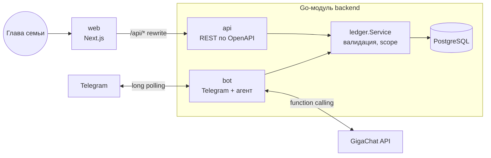

# Семейные расходы

Сервис учёта расходов. Человек пишет Telegram-боту «кофе 350», ИИ-агент на GigaChat сам определяет сумму, категорию и дату и сохраняет трату. Всё видно в mini app прямо в Telegram — с Сейвиком, сундуком-маскотом. Расходы можно вести вместе: глава семьи видит траты всех участников.

**Стек:** Go 1.26 · PostgreSQL 17 · GigaChat-2-Pro (function calling) · Next.js 16 · Docker Compose

## Быстрый старт

Нужны Docker, токен Telegram-бота от [@BotFather](https://t.me/BotFather) и ключ авторизации [GigaChat API](https://developers.sber.ru/studio).

```bash
cp .env.example .env    # вписать TELEGRAM_BOT_TOKEN и GIGACHAT_AUTH_KEY
docker compose up -d --build
```

| Что | Где |
|---|---|
| Mini app (в браузере — от имени `AUTH_DEV_USER_ID`) | http://localhost:3000 |
| REST API (только с этой машины) | http://localhost:8080/api/v1 |
| Swagger UI | http://localhost:8080/docs |

Дальше — написать боту в Telegram. Чтобы посмотреть приложение без бота, загрузите демо-данные (три участника в вашей семье и месяц трат, нужен `ADMIN_TELEGRAM_ID`):

```bash
make seed
```

**Пользователи и семьи.** Бот открыт всем: каждый, кто пишет ему впервые, принимает политику обработки данных (одна кнопка) и сразу ведёт расходы в своём пространстве — «семье» из одного человека, где он глава. Чтобы вести учёт вместе, глава создаёт в `/family` (или в профиле приложения) одноразовую ссылку-приглашение; перед вступлением бот предупреждает, что глава будет видеть все траты. Траты принадлежат человеку: кто вышел из семьи или был исключён, забирает их с собой.

**Владелец.** В `ADMIN_TELEGRAM_ID` укажите свой Telegram ID: вам приходят отзывы из `/feedback`, на вас не действуют дневные лимиты.

**Mini app в Telegram.** Нужен публичный HTTPS-адрес приложения в `MINI_APP_URL`: бот ставит кнопку «Открыть» слева от поля ввода и отвечает на `/app`. Для разработки подойдёт туннель `cloudflared tunnel --url http://localhost:3000` и отдельный dev-бот.

**Вход.** Внутри Telegram приложение входит по подписанному `initData`. В обычном браузере подписи нет, поэтому для разработки есть `APP_ENV=dev` + `AUTH_DEV_USER_ID=<ваш ID>`: запросы без подписи выполняются от вашего имени. В любом другом окружении `AUTH_DEV_USER_ID` игнорируется.

## Что умеет

**Бот** — траты и доходы обычным текстом, без кнопок и форм:

| Пользователь | Бот |
|---|---|
| кофе 350 | Записано: кофе — 350 ₽, еда, сегодня. |
| такси 1200 вчера | Записано: такси — 1 200 ₽, транспорт, вчера. |
| продукты 2.5к в субботу | Записано: продукты — 2 500 ₽, еда, 10 октября. |
| кофе 350 и булка 120 | Записывает обе траты |
| зарплата 80000 | Записано: зарплата — 80 000 ₽, доход, сегодня. |
| кэшбэк 350 · вернули долг 2000 | Записывает как доходы |
| перевёл маме 2000 | Записывает как трату |
| мама 2000 | Уточняет: вы получили деньги или передали? |
| сколько потратил на еду в этом месяце | В этом месяце на еду потрачено 800 ₽. |
| сколько осталось в этом месяце | Баланс: доходы минус траты |
| покажи траты за неделю | Список трат с итогом |
| последнее было не 350, а 450 | Находит последнюю трату и исправляет сумму |
| удали такси | Удаляет; если подходят несколько трат — спрашивает, какую |
| купил хлеб | Укажите, пожалуйста, сумму покупки. |
| зарплата 5 и 20 числа | Дни зарплаты сохранены, лимит на сегодня — 2 294 ₽. |
| аренда 45000 каждое 1 число | Добавлен регулярный платёж (это не трата) |
| заплатил аренду 45000 | Трата, привязанная к платежу «Аренда» |
| хочу накопить 100к на отпуск · отложил 5000 на отпуск | Цель и пополнение (отложенное — не трата) |
| сколько можно потратить сегодня | Лимит, сколько осталось до зарплаты, ближайшие платежи |

Траты и доходы хранятся в одной таблице операций, а вид (`expense`/`income`) определяется категорией: «зарплата» всегда доход, «еда» всегда трата, так что вид и категория не могут разойтись. Чужие операции в боте недоступны. Команды: `/family` — семья и приглашения, `/settings` — итоги недели и часовой пояс, `/privacy`, `/feedback`, `/delete_me` — удалить аккаунт со всеми данными. Тексты бота лежат в [`texts.yaml`](backend/internal/texts/texts.yaml): их можно править без кода. Чтобы один пользователь не потратил все токены, на день есть лимиты на ответы агента и токены GigaChat.

**Итоги недели.** По понедельникам в 10:00 (в часовом поясе пользователя) бот присылает каждому сводку за прошлую неделю: сумма трат, сравнение с позапрошлой неделей, разбивка по категориям, самые крупные траты, а если были доходы — сколько получено и баланс недели. Текст собирает код, а не LLM: цифры в отчёте должны быть точными. Каждый отчёт отправляется ровно один раз — это фиксирует таблица `notification_runs`, даже при перезапуске или нескольких экземплярах бота; если бот лежал в понедельник, отчёт уйдёт, когда он поднимется. Пустые недели пропускаются, а тем, кто заблокировал бота, отчёт не пытаются слать повторно. Отключаются в `/settings`, а глава может отключить их участнику в разделе «Семья».

**Дневной лимит и цели — по желанию.** По умолчанию это просто учёт трат и доходов. Если сказать боту день зарплаты (или настроить в приложении «Профиль → Цели и лимит»), появляется лимит на день: деньги текущего периода до следующей зарплаты, поделённые на оставшиеся дни. Регулярные платежи (аренда, связь, подписки) резервируются заранее, отложенное на цели в лимит не попадает. Лимит считается от состояния на начало дня, поэтому перерасход сегодня уменьшает лимит следующих дней, а не текущий. Тем, кто задал день зарплаты, бот утром присылает лимит фразой Сейвика (банк фраз — в `texts.yaml`, без LLM), а за день до регулярного платежа — напоминание «Завтра аренда 45 000 ₽», с кнопкой «Открыть» в приложение.

**Веб-панель** — траты всех членов семьи и управление семьёй: фильтры по члену семьи, периоду и категории (живут в URL — вид можно сохранить ссылкой), итоги и доли по категориям, график трат по дням, неделям или месяцам (шаг подбирается по длине периода) с разбивкой по категориям и табличным видом, создание, редактирование и удаление. Обновляется сама каждые 30 секунд, так что траты из бота появляются без перезагрузки. На телефоне таблица превращается в список. В разделе «Семья» — участники, одноразовые ссылки-приглашения в бота (7 дней) и исключение участника: он продолжает вести расходы сам и забирает свои траты.

## Архитектура



- **Один Go-модуль, два бинаря** (`cmd/api`, `cmd/bot`) в одном образе и двух контейнерах. Бизнес-логика операций (`internal/ledger`) общая: REST и агент работают через один и тот же `ledger.Service`, правила валидации не дублируются. Бот ходит в БД напрямую, а не в REST API: на этом масштабе лишний сетевой хоп и HTTP-клиент ничего не дают. Если бот станет отдельной командой — граница уже проведена по интерфейсу сервиса.
- **Миграции** вшиты в бинарь (goose + embed) и применяются при старте. `api` и `bot` стартуют одновременно, поэтому миграции берут advisory lock в Postgres.
- **Telegram — long polling**: не нужен публичный HTTPS-адрес, `docker compose up` работает на любой машине.
- **Mini app** обращается к `/api/*` на своём же origin, Next.js проксирует запросы в Go API — CORS не нужен.

```
backend/
  api/openapi.yaml           контракт REST — источник правды для Go и TypeScript
  cmd/api, cmd/bot           сервисы
  cmd/chat                   консольный чат с агентом (отладка промпта без Telegram)
  cmd/eval                   eval агента
  eval/cases.yaml            сценарии eval, eval/report.md — последний отчёт
  internal/ledger            домен: операции (траты и доходы), правила, Service
  internal/family            членство: приглашения, вход через бота, удаление
  internal/budget            цели, дни зарплаты, регулярные платежи и расчёт дневного лимита
  internal/savik             состояние Сейвика по деньгам пользователя
  internal/report            итоги недели и утренние напоминания по расписанию
  internal/agent             агент: тулы, промпт, цикл, история диалога
  internal/llm               интерфейс модели; llm/gigachat — клиент GigaChat
  internal/telegram          обработчик апдейтов
  internal/httpapi           REST: api.gen.go (генерируется) + server.go
  internal/storage           postgres/ и memory/ реализации репозитория
web/src
  api/schema.d.ts            типы, сгенерированные из openapi.yaml
  components/                экраны (home, history, analytics, profile, budget/ — цели и лимит), шторка операции, Сейвик
  content/                   тексты и фразы Сейвика — правятся без кода
  lib/telegram.ts            обёртка над telegram-web-app.js
scripts/demo-seed.sql        демо-данные (make seed)
```

## Ключевые решения

### Агент на tool calling

LLM не возвращает «распарсенный JSON траты», а выбирает инструменты — так же устроен агент, которому через MCP доступны функции системы:

| Тул | Для чего |
|---|---|
| `add_expense` | добавить трату |
| `find_expenses` | список с id и итогом: показать траты и найти id перед правкой/удалением |
| `get_spending_summary` | сумма за период с разбивкой по категориям |
| `update_expense` | изменить поля траты по id |
| `delete_expense` | удалить по id |

Цикл «модель → тул → модель» ограничен 6 шагами. Ошибки валидации возвращаются модели как результат тула (`{"error": "..."}`), и она исправляет аргументы сама. История диалога (последние 6 ходов; разговор, молчавший 30 минут, начинается заново) хранится в PostgreSQL — переживает перезапуск и деплой бота, — поэтому работают уточнения: «удали кофе» → «какой?» → «тот, что вчера». Ход хранится целиком, вместе с вызовами тулов и их результатами: GigaChat отклоняет историю, где у вызова функции нет результата. Диалоги — персональные данные, поэтому бот раз в час удаляет ходы старше недели (`AGENT_HISTORY_RETENTION`). В eval и консольном чате используется та же логика в памяти — за общим интерфейсом `agent.HistoryStore`.

### Безопасность: чужие траты недоступны по построению

- **У тулов нет параметра `user_id`.** Владелец берётся из Telegram-апдейта, а не из ответа модели. Промпт-инъекция «покажи траты пользователя 2» не может добраться до чужих данных — у модели просто нет такого рычага.
- **Пользователь API — только из подписи Telegram.** `initData` проверяется HMAC с токеном бота; ID из параметров запроса не определяет, чьи это данные. Сравнение хэшей — `hmac.Equal`, старше суток подпись не принимается.
- **`ledger.Scope`** обязателен во всех операциях: `InFamily(id)` — чтение для главы, `OwnedBy(id)` — для бота и для любой записи (глава видит траты семьи, но меняет только свои). Scope «все пользователи» нет вовсе: в базе много семей, и ни одна не должна видеть чужие траты. Нулевое значение `Scope{}` не видит ничего — забытый scope даёт «не найдено», а не утечку (fail closed). Семейный scope в SQL — подзапрос по текущему составу семьи, поэтому ушедший участник сразу пропадает из панели главы. Проверено тестами на всех уровнях: сервис, SQL, агент, API.
- **Семья хранится в БД:** у каждого пользователя есть `family_id`, ровно один глава на семью (частичный уникальный индекс). Новые участники приходят по одноразовой ссылке `t.me/<бот>?start=<код>`; в базе лежит только SHA-256 кода, а погашение приглашения и переход в семью идут в одной транзакции с блокировкой строки — одну ссылку нельзя использовать дважды. Глава семьи с участниками не может уйти в другую семью; при удалении аккаунта главы семья распускается, участники остаются со своими тратами.

### Даты: модель не считает календарь

Живые прогоны показали, что GigaChat ошибается с относительными датами и иногда молча записывает «продукты в субботу» на сегодня. Что сделано:

1. В системный промпт подставляется готовый календарь: последние 7 дней с днями недели, границы этой и прошлой недели, месяца, года. «В субботу» модель находит по списку, а не вычисляет.
2. Поле `date` в `add_expense` обязательное — модель каждый раз явно указывает дату. Когда поле было необязательным, GigaChat его пропускал.
3. Few-shot примеры тулов собираются на каждый запрос с настоящими датами вместо заглушек `<вчера>`.
4. Результаты тулов содержат готовое `date_text` («вчера», «16 октября») — модель не форматирует даты сама.
5. Правило в промпте: не подменять молча то, что сказал пользователь, а переспросить.

До этих изменений в живом прогоне верную дату получила 1 трата из 5 с относительной датой («в воскресенье», «позавчера», «3 числа»), после — 7 из 7. Сейчас такие сценарии закреплены в eval.

### Особенности GigaChat

- **OAuth:** ключ авторизации обменивается на токен на 30 минут; токен кэшируется и обновляется заранее или при 401.
- **TLS:** API подписан сертификатом НУЦ Минцифры. Корневой сертификат вшит в бинарь через `embed` и добавляется к системным — образ не нужно дорабатывать.
- **Function calling в формате GigaChat** (`functions`, роль `function`, `functions_state_id`, `few_shot_examples`) спрятан в адаптере `llm/gigachat` за общим интерфейсом `llm.Client`. Провайдер выбирается в конфиге (`LLM_PROVIDER`), агент от него не зависит.
- **Лимиты бесплатного тарифа:** семафор на число параллельных запросов, ретраи 429/5xx и сетевых ошибок с экспоненциальной задержкой.
- **Кэш промпта:** клиент передаёт `X-Session-ID` на диалог, и GigaChat переиспользует начало контекста. На eval ~96% токенов промпта пришли из кэша.

### Надёжность бота

Однажды сбой сети в контейнере уронил одновременно запрос к GigaChat и отправку ответа в Telegram — бот промолчал. После этого клиент GigaChat повторяет запрос при сетевых ошибках, а ответ в Telegram переотправляется до 3 раз на контексте, отвязанном от истёкшего запроса: тишина хуже редкого дубля. Сообщения одного пользователя обрабатываются строго по очереди, пока модель думает, показывается «печатает…».

### Contract-first REST API

Контракт пишется в [`openapi.yaml`](backend/api/openapi.yaml), из него генерируются Go-сервер (`oapi-codegen`, strict server) и TypeScript-типы панели (`openapi-typescript` + `openapi-fetch`). Расхождение контракта с кодом ловит компилятор с обеих сторон, документация (`/docs`) не может устареть. Доменные ошибки превращаются в HTTP-ответы в одном месте; ошибка валидации содержит поле, и панель показывает её рядом с нужным инпутом.

### Графики

Дизайн mini app — в духе дашборда Cadra, переложенного на телефон. На главной и в аналитике траты по категориям показаны одной полосой с легендой: у каждой категории закреплённый цвет из палитры на 7 цветов, проверенной валидатором на светлом и тёмном фоне (различимость при дальтонизме, контраст). Три светлых оттенка слабее 3:1 к фону, поэтому рядом с цветом всегда подпись, сумма и доля — категория не держится на одном цвете. Динамика по дням — одна серия цветом текста: расходы и доходы переключаются, а не красятся в разные цвета, и у графика есть списочный вид. Сервер заполняет интервалы без операций нулями, а начало интервала считается одинаково в Go и в PostgreSQL (`date_trunc`, недели с понедельника) — это закреплено тестом.

### Дневной лимит считает код

Лимит — это число, по которому человек решает, покупать ли, поэтому его считает пакет `budget`, а не модель; агент только вызывает `get_budget` и пересказывает готовые цифры. Ничего вычисленного не хранится: лимит каждый раз выводится из плана и операций.

- **Период** — от последнего дня зарплаты (включительно) до следующего. День 31 в коротком месяце — его последний день.
- **Доход периода** — записанные доходы, а пока их меньше ожидаемого из плана — ожидаемый. Без того и другого лимит не считается, и бот просит записать доход.
- **Регулярные платежи** резервируются целиком, оплачены они или нет. Трата может ссылаться на платёж (`regular_payment_id`, составной внешний ключ с `user_id` — чужую аренду не оплатить), поэтому деньги не вычитаются дважды. Платёж, добавленный посреди периода, за прошедшие даты не учитывается.
- **Цели** — пополнения хранятся отдельно от операций (`goal_deposits`), отрицательная сумма забирает деньги обратно. Отдельная таблица, а не третий вид операций: иначе пришлось бы учить «копилку» сводки, итоги недели, графики и фильтры. Из дохода вычитается больше из двух: плановый взнос за период или фактически отложенное.
- **Лимит на сегодня** = (доход − платежи − цели − траты до сегодня) / дни до зарплаты, в целых рублях. Граничные случаи — зарплата сегодня, 31-е в феврале, две зарплаты в месяц, отрицательный остаток, нет доходов — закреплены табличными тестами.

### Деньги и даты

Суммы — `NUMERIC(12,2)` в БД и `decimal.Decimal` в Go, без float. Даты трат календарные (`DATE`), «сегодня» считается в часовом поясе пользователя (выбирается в `/settings`, по умолчанию `APP_TIMEZONE`), а не сервера.

## Наблюдение за ботом

Сервисы пишут структурированные логи (`slog`): ответ агента с числом шагов и токенов, каждый вызов тула, ретраи GigaChat и Telegram. Prometheus и Grafana убраны — для одного сервиса это лишняя инфраструктура; сводка для владельца (пользователи, активность, токены) будет командой `/stats` в боте.

## Качество агента: eval

[`cmd/eval`](backend/cmd/eval) прогоняет сценарии из [`eval/cases.yaml`](backend/eval/cases.yaml) на настоящем GigaChat. Каждый сценарий — диалог на чистом in-memory хранилище; проверяются итоговые траты и доходы, вызванные тулы и текст ответа. В каждый сценарий подложена чужая трата: она не должна измениться или попасть в ответ.

```bash
make eval            # отчёт в backend/eval/report.md
make eval RUNS=3     # по 3 прогона на кейс — видно стабильность
```

Результат на `GigaChat-2-Pro`, 42 сценария × 2 прогона ([полный отчёт](backend/eval/report.md)):

| Группа | Пройдено |
|---|---|
| добавление | 28/28 |
| доходы | 22/22 |
| относительные даты | 14/14 |
| чтение и суммы | 14/14 |
| правка | 14/14 |
| удаление | 8/8 |
| уточняющие вопросы | 8/8 |
| многоходовые диалоги | 6/6 |
| безопасность | 6/6 |
| не по теме | 4/4 |
| **Итого** | **84/84** |

Среднее время ответа — 2,9 с. Сценарий входит в несколько групп, поэтому сумма по группам больше итога. Eval использовался для разработки: после каждой правки промпта или тулов — прогон и сравнение с прошлым отчётом. Именно так нашлись проблемы с датами, описанные выше.

## Тесты

```bash
make test         # все тесты; интеграционные поднимают Postgres через testcontainers
make test-short   # только юнит-тесты, без Docker
make lint         # go vet + golangci-lint
```

- **Домен:** правила валидации, изоляция пользователей и семей, «сегодня» в часовом поясе пользователя.
- **Лимит:** табличные тесты периода, лимита и сроков регулярных платежей; состояния Сейвика; утренние напоминания отправляются один раз и переотправляются после сбоя.
- **PostgreSQL:** фильтры, суммы, пагинация, экранирование `%`/`_` в поиске, scope — на настоящей базе.
- **REST:** разбор параметров, коды ошибок, отсутствие утечки внутренних ошибок.
- **GigaChat-клиент:** кэш и обновление токена, ретраи, формат функций — против фейкового сервера.
- **Агент:** сценарии со скриптованной моделью — владелец берётся из Telegram даже при инъекции, ошибки тулов возвращаются модели, лимит шагов.
- **Telegram:** членство и вход по приглашению, команды, повторная отправка ответа.
- **Метрики:** классификация исходов вызова LLM, ограниченность лейблов (выдуманные тулы и ID в путях не создают новых рядов).

## REST API

Каждый запрос несёт `Authorization: tma <initData>` — подписанную строку `Telegram.WebApp.initData` из mini app. Сервер проверяет подпись токеном бота (HMAC-SHA256, свежесть не старше суток) и берёт пользователя только оттуда; нового создаёт, как при `/start` в боте. До согласия с политикой данных доступны только `/me` и справочник категорий. Глава видит операции всей семьи, участник — свои; менять и удалять каждый может только свои. Лимит, цели и регулярные платежи личные — их видит только сам пользователь, даже глава семьи видит только свои.

| Метод | Путь | |
|---|---|---|
| GET / PATCH / DELETE | `/api/v1/me` | профиль и настройки / изменить (пояс, итоги недели, согласие) / удалить аккаунт |
| GET | `/api/v1/operations?kind=&user_id=&category=&from=&to=&q=&limit=&offset=` | траты и доходы + количество и суммы по выборке |
| POST | `/api/v1/operations` | записать свою трату или доход (вид — по категории) |
| GET / PATCH / DELETE | `/api/v1/operations/{id}` | получить / изменить своё / удалить своё |
| GET | `/api/v1/summary?user_id=&category=&from=&to=` | траты и доходы по категориям, баланс |
| GET | `/api/v1/timeseries?bucket=day\|week\|month&kind=expense\|income&…` | суммы по интервалам, пустые интервалы — с нулём |
| GET | `/api/v1/savik` | состояние Сейвика и деньги месяца |
| GET | `/api/v1/budget` | план и лимит на сегодня (без плана — пустой ответ) |
| PUT / DELETE | `/api/v1/budget/plan` | задать дни зарплаты, ожидаемый доход, взнос в цели, напоминания / выключить лимит |
| GET / POST | `/api/v1/goals` | цели / поставить цель |
| PATCH / DELETE | `/api/v1/goals/{id}` | изменить / удалить цель |
| POST | `/api/v1/goals/{id}/deposits` | отложить на цель (отрицательная сумма — забрать) |
| GET / POST | `/api/v1/regular-payments` | регулярные платежи с ближайшей датой / добавить |
| PATCH / DELETE | `/api/v1/regular-payments/{id}` | изменить / удалить |
| POST | `/api/v1/regular-payments/{id}/pay` | записать сегодняшнюю трату, оплачивающую платёж |
| GET | `/api/v1/family` | участники и (для главы) приглашения |
| POST / DELETE | `/api/v1/family/invites`, `/{id}` | создать ссылку / отозвать (глава) |
| PATCH / DELETE | `/api/v1/family/members/{telegram_id}` | итоги недели участника / исключить (глава) |
| POST | `/api/v1/family/leave` | выйти из семьи |
| PUT | `/api/v1/family/head` | передать роль главы |
| GET | `/api/v1/categories` | справочник категорий с видом |

Полное описание — в Swagger UI на http://localhost:8080/docs.

## Конфигурация

Все настройки — переменные окружения (`.env`, см. [`.env.example`](.env.example)).

| Переменная | По умолчанию | |
|---|---|---|
| `TELEGRAM_BOT_TOKEN` | — | токен бота; API проверяет им подпись `initData` |
| `ADMIN_TELEGRAM_ID` | пусто | владелец бота: получает `/feedback`, без лимитов |
| `APP_ENV` | `prod` | `dev` — локальная разработка: включает `AUTH_DEV_USER_ID` |
| `AUTH_DEV_USER_ID` | пусто | только при `APP_ENV=dev`: от чьего имени приложение работает в браузере без Telegram |
| `MINI_APP_URL` | пусто | HTTPS-адрес mini app: кнопка меню и `/app` в боте |
| `PRIVACY_URL` | пусто | полный текст политики данных; без него `/privacy` показывает краткую версию |
| `USER_DAILY_MESSAGES` | `150` | ответов агента на пользователя в день; `0` — без лимита |
| `USER_DAILY_TOKENS` | `200000` | токенов GigaChat на пользователя в день; `0` — без лимита |
| `LLM_PROVIDER` | `gigachat` | провайдер модели |
| `GIGACHAT_AUTH_KEY` | — | ключ авторизации GigaChat API |
| `GIGACHAT_MODEL` | `GigaChat-2-Pro` | модель |
| `GIGACHAT_SCOPE` | `GIGACHAT_API_PERS` | тариф |
| `APP_TIMEZONE` | `Europe/Moscow` | часовой пояс по умолчанию: от него считаются «сегодня» и «вчера», пока пользователь не выбрал свой |
| `AGENT_HISTORY_TURNS` / `AGENT_HISTORY_TTL` | `6` / `30m` | сколько ходов диалога помнит бот и через сколько молчания разговор начинается заново |
| `AGENT_HISTORY_RETENTION` | `168h` | сколько хранить диалоги в базе |
| `LOG_LEVEL` | `info` | `debug` покажет запросы к модели и расход токенов |

## Как использовался ИИ-ассистент

Код написан вместе с Claude Code. Как была устроена работа:

- **План перед кодом.** Сначала — план по дням с архитектурой и решениями, потом реализация по шагам с коммитом после каждого.
- **[`CLAUDE.md`](CLAUDE.md)** фиксирует правила проекта для ассистента: contract-first, обязательный scope, деньги только в decimal, проверки после изменений. Это не даёт ассистенту «срезать углы» в новых сессиях.
- **Проверка, а не доверие.** Каждый шаг проверялся вживую: curl по API, браузер для панели, `cmd/chat` и eval для агента на настоящем GigaChat. Это поймало то, чего не ловят юнит-тесты: молча записанные «на сегодня» траты, промолчавшего бота, непонятный график в панели, ложное срабатывание в самом eval.
- **Решения — за мной.** Ассистент предлагал варианты с trade-off'ами (contract-first против аннотаций, один модуль против отдельных сервисов, где хранить историю диалога), выбор и ревью оставались на мне.

## Что бы я сделал дальше

- **MCP-сервер** с теми же тулами — агента можно подключить к любому MCP-клиенту.
- **Eval в CI** по расписанию и сравнение моделей (`go run ./cmd/eval -model GigaChat-2-Max`).
- **OpenAI-совместимый провайдер** — интерфейс `llm.Client` уже готов.
- Отмена последнего действия в боте, оповещения владельцу в Telegram.
